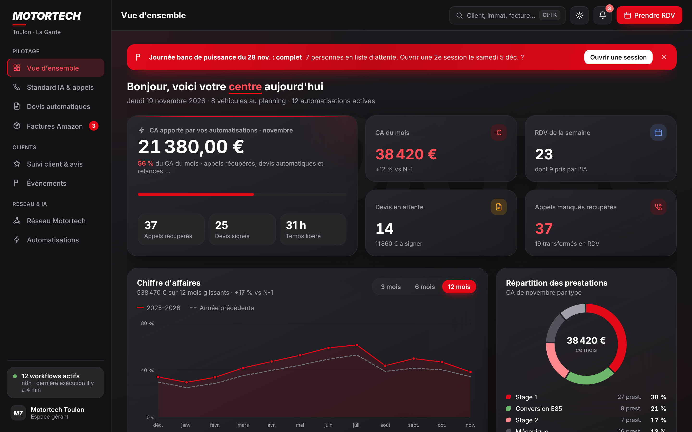
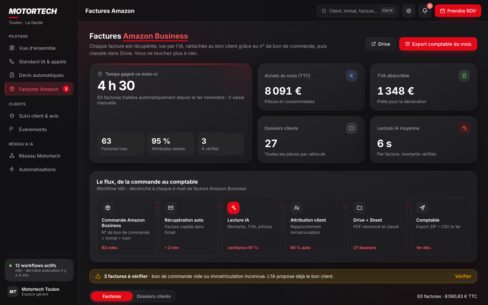
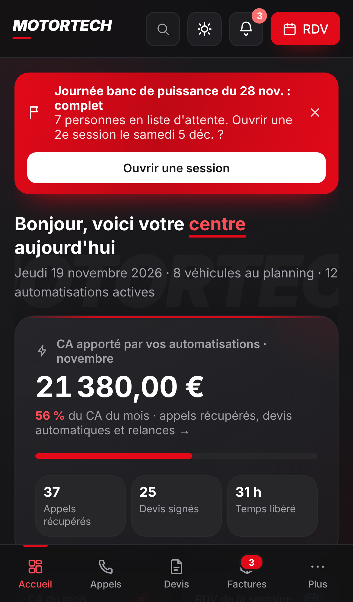

# Motortech Toulon · Dashboard de pilotage

Démo de tableau de bord sur mesure pour **Motortech Toulon (La Garde, Var)**. Elle présente au gérant les
automatisations IA (workflows n8n) qui peuvent tourner pour son centre : reprogrammation Stage 1/2/3,
conversion E85, nettoyage FAP, mécanique et banc de puissance.

Le design reprend celui de l'app **Appesteban** : même structure, mêmes composants, verre dépoli, animations en
cascade et navigation mobile. Seule la palette change, pour suivre l'identité de motortech.fr.

## Lancer en local

```bash
npm install
```

```bash
npm run dev
```

L'app est servie sur http://localhost:5173. Le serveur écoute aussi sur le réseau local (`host: true`), donc on
peut l'ouvrir depuis un téléphone branché sur le même Wi-Fi.

Pour tester le build de production :

```bash
npm run build && npm run preview
```

## Déployer sur Vercel

1. Pousser le dépôt sur GitHub.
2. Sur vercel.com : **Add New → Project**, importer le dépôt. Vercel détecte Vite tout seul (`vercel.json` fixe aussi
   `npm run build` et le dossier `dist`).
3. Déployer. Il n'y a aucune variable d'environnement à renseigner : toutes les données sont des JSON statiques.

Ou en ligne de commande :

```bash
npx vercel --prod
```

## Stack (identique à Appesteban)

- React 18 et Vite 5. Aucune autre dépendance.
- CSS natif piloté par des variables :
  - `variables.css` : tokens de structure ;
  - `global.css`, `layout.css`, `components.css` : copiés d'Appesteban ;
  - `glass.css` : le design system en verre, avec la palette Motortech ;
  - `motortech.css` : les composants propres au dashboard.
- Icônes SVG faites maison (`src/components/icons.jsx`).
- Graphiques en SVG fait maison : courbes avec morphing animé, anneau, barres, courbes du banc de puissance.
  Les SVG sont dessinés à la largeur réelle de l'écran, pour que les libellés restent lisibles sur téléphone.
- Navigation par état (`AppContext`), sans routeur.

## Modules

| Page | Contenu |
|---|---|
| Vue d'ensemble | 4 KPI, CA apporté par l'IA, CA sur 12 mois (N vs N-1), répartition des prestations, planning du jour, fil des automatisations, bandeau d'alerte, filigrane MOTORTECH |
| Standard IA & appels | Journal avec statut, résumé IA, besoin et véhicule ; appels du lundi et de 12h–14h mis en avant ; répartition par heure et par jour |
| Devis automatiques | Demandes du formulaire du site, gains ch/Nm, prix, statuts, relances J+2 / J+7, entonnoir de conversion |
| **Factures Amazon Business** | Tableau filtrable (client, mois, statut, recherche par immatriculation), aperçu du PDF renommé, champs lus par l'IA, validation des factures « à vérifier », dossiers clients, export comptable ZIP + CSV, temps gagné, schéma du flux |
| Suivi client & avis | Courbes du banc envoyées, demandes d'avis Google, rappels d'entretien (E85), évolution des avis |
| Événements | Journées banc, soirée E85, track day ; inscrits, liste d'attente, rappels automatiques |
| Réseau | Classement des 12 centres Motortech (CA, conversion, leads) |
| Automatisations | 13 workflows n8n : déclencheur, dernière exécution, exécutions du mois, interrupteur on/off |

Également inclus : recherche globale ⌘K / Ctrl K (clients, immatriculations, factures), bouton « Prendre RDV »,
notifications, thème sombre par défaut avec bascule vers le thème clair.

## Données

Les données sont dans `src/data/*.json`. Elles sont fictives mais réalistes : clients varois, vraies marques et vrais
modèles, gains de reprogrammation plausibles.

L'horloge de la démo est figée au **jeudi 19 novembre 2026 à 16h42** (`src/utils/constants.js`), pour que tout reste
cohérent : planning du jour, « il y a 4 min », etc.

Les factures Amazon sont générées par un script déterministe (même résultat à chaque exécution) :

```bash
npm run data:invoices
```

## Correspondance des couleurs

| Rôle | Appesteban (sombre) | Motortech |
|---|---|---|
| Fond | `#15100D` | `#18181B` |
| Sidebar / topbar / bottom nav | verre | `#111113` (86 %) |
| Surfaces | `#1E1714` | `#1F1F23` |
| Bordures | blanc 10–14 % | `#2A2A2F` |
| Texte / secondaire | `#F3EAE3` / `#B8A89C` | `#FFFFFF` / `#A1A1AA` |
| Accent (aplats) | corail `#FF6B5B` | rouge Motortech `#E20919`, survol `#C00815` |
| Accent (petits textes) | — | `#FF4D57` (contraste AA 5,0:1) |
| Succès / E85 | `#34D399` | `#6CB769` (`.mtk-e85` du site) |
| Avertissement | `#FBBF24` | `#F59E0B` |
| Info / RDV | `#A78BFA` | `#6E9BEF` |
| Danger | `#FB7185` | `#F87171` |

Les valeurs rouges et zinc viennent du CSS de production de motortech.fr. Le rouge reste rare : il sert aux boutons
principaux, à l'onglet actif, aux KPI clés et au seul bandeau d'alerte.

## Aperçu






